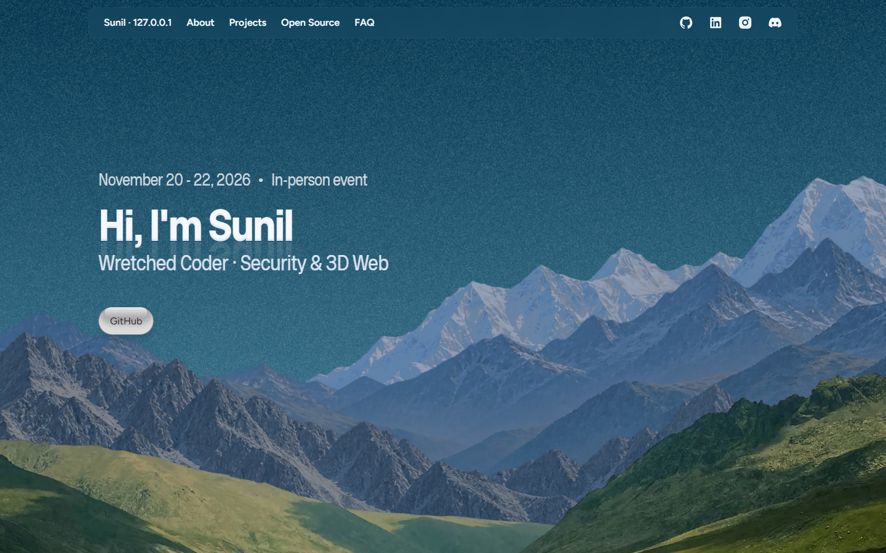
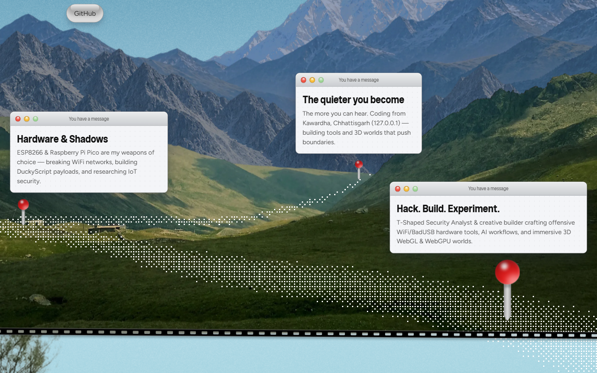
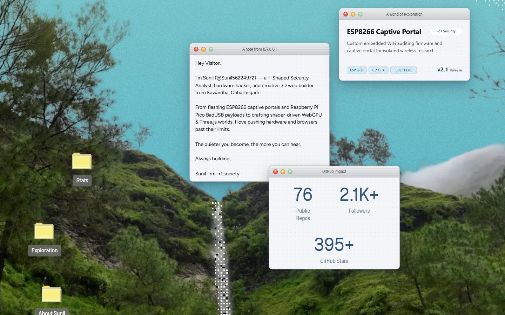
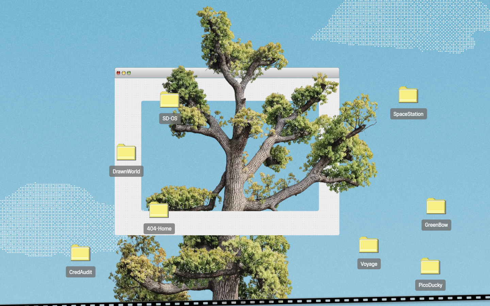
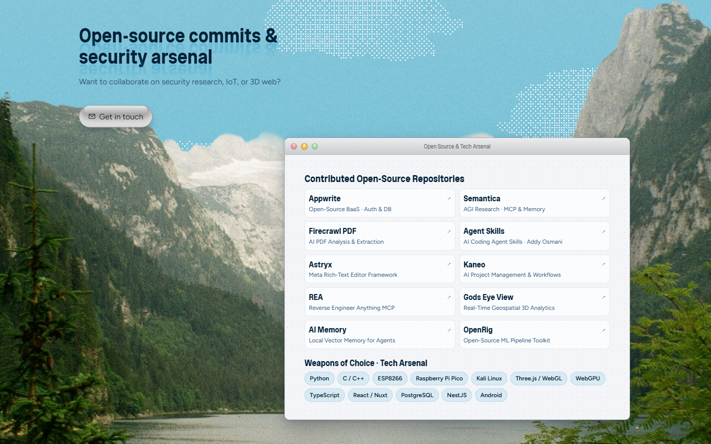
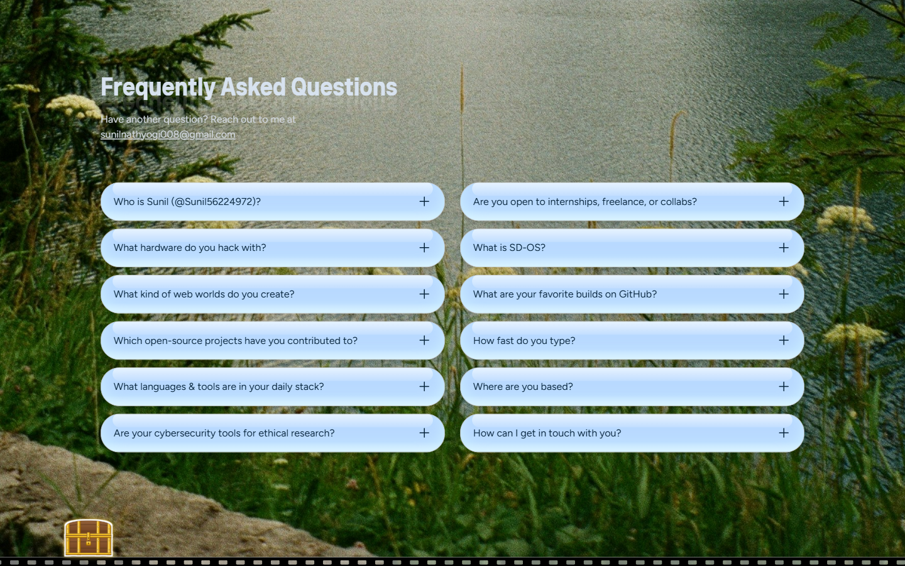
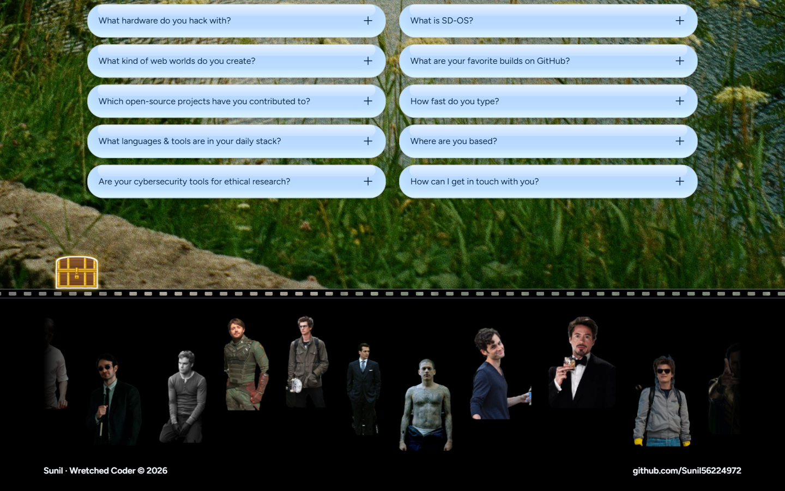

<div align="center">

# Sunil · Wretched Coder

### Interactive Retro-macOS & Alpine Parallax Developer Portfolio

[](https://damn-shit.vercel.app)
[](https://github.com/Sunil56224972)
[](https://damn-shit.vercel.app/#projects)
[](./LICENSE)

<br />

<a href="https://damn-shit.vercel.app">
  
</a>

<p>
  <em>Alpine parallax landscapes, brushed-metal macOS Aqua windows, dithered pixel trails, and interactive creative builds — crafted for <strong>Sunil (@Sunil56224972)</strong>.</em>
</p>

[**Explore Live Website ↗**](https://damn-shit.vercel.app) · [**Featured Builds**](https://damn-shit.vercel.app/#projects) · [**Open Source**](https://damn-shit.vercel.app/#sponsors) · [**GitHub Profile**](https://github.com/Sunil56224972)

</div>

---

## Overview

**Damn-Shit** ([`damn-shit.vercel.app`](https://damn-shit.vercel.app)) is the interactive personal portfolio of **Sunil** (`@Sunil56224972` · *Wretched Coder*), a creative 3D web builder, open-source contributor, and embedded IoT & security researcher from Kawardha, Chhattisgarh (`127.0.0.1`).

Designed around a continuous top-to-bottom journey—from snow-capped alpine peaks down through a dithered pixel waterfall, sky-canopy oak tree, serene mountain lake, and perforated film-strip footer—the site merges nostalgic **macOS Aqua UI** windows with modern smooth-scroll choreography.

---

## Visual Tour

<table width="100%">
  <tr>
    <td width="50%" align="center" valign="top">
      <a href="https://damn-shit.vercel.app">
        
      </a>
      <br />
      <strong>1 · Scroll-Driven Alpine Trail</strong>
      <br />
      <sub>Dithered pixel path &amp; pinned macOS message cards revealed on scroll</sub>
    </td>
    <td width="50%" align="center" valign="top">
      <a href="https://damn-shit.vercel.app/#about">
        
      </a>
      <br />
      <strong>2 · Retro macOS Desktop &amp; Live Deck</strong>
      <br />
      <sub>Draggable Aqua windows, GitHub impact metrics &amp; cycling project slides</sub>
    </td>
  </tr>
  <tr>
    <td width="50%" align="center" valign="top">
      <a href="https://damn-shit.vercel.app/#projects">
        
      </a>
      <br />
      <strong>3 · Interactive Project Tree Explorer</strong>
      <br />
      <sub>Clickable desktop build folders orbiting a framed sky-canopy oak tree</sub>
    </td>
    <td width="50%" align="center" valign="top">
      <a href="https://damn-shit.vercel.app/#sponsors">
        
      </a>
      <br />
      <strong>4 · Open-Source Commits &amp; Tech Arsenal</strong>
      <br />
      <sub>10 contributed OSS repositories alongside daily engineering tools</sub>
    </td>
  </tr>
  <tr>
    <td width="50%" align="center" valign="top">
      <a href="https://damn-shit.vercel.app/#faq">
        
      </a>
      <br />
      <strong>5 · Glossy Aqua FAQ &amp; Easter Eggs</strong>
      <br />
      <sub>12 skeuomorphic accordion pills &amp; interactive lakeside treasure chest</sub>
    </td>
    <td width="50%" align="center" valign="top">
      <a href="https://damn-shit.vercel.app/#faq">
        
      </a>
      <br />
      <strong>6 · Sinusoidal Character Wave Marquee</strong>
      <br />
      <sub>Perforated 35mm film divider &amp; 15 iconic character cutouts in wave motion</sub>
    </td>
  </tr>
</table>

---

## Interactive Highlights

- **Scroll-Coupled Dithered Trail** — As you descend the mountain hero, a canvas-rendered pixel trail dynamically traces across the terrain and pins three `"You have a message"` Aqua cards.
- **Draggable & Minimizable macOS Windows** — Classic brushed-aluminum titlebars with working traffic-light controls, dot-matrix `#f4f5f8` canvases, desktop shortcut folders (`Stats`, `Exploration`, `About Sunil`), and an auto-crossfading 10-slide build showcase (`A world of exploration`).
- **Interactive Oak Tree Build Explorer** — Eight desktop folders (`SD-OS`, `SpaceStation`, `DrawnWorld`, `404-Home`, `GreenBow`, `Voyage`, `PicoDucky`, `CredAudit`) animate into view via `IntersectionObserver` and open rich detail modals with live deployment and source links.
- **Open-Source & Arsenal Window** — Highlights contributions to **Appwrite**, **Semantica**, **Firecrawl PDF**, **Agent Skills**, **Astryx**, **Kaneo**, **REA**, **Gods Eye View**, **AI Memory**, and **OpenRig**, paired with core stack badges.
- **Custom Pixel Cursors & WebAudio Feedback** — Retro pixel pointer/hand cursors, glossy Aqua pill accordions, an interactive treasure chest, and a 15-cutout sinusoidal wave footer linking directly to repositories.

---

## Featured Builds Showcased

| Build | Category | Stack | Links |
| :--- | :--- | :--- | :--- |
| **SD-OS** | Browser Desktop & CLI Portfolio | JavaScript · HTML5 · CSS3 · Retro UI | [Live](https://sunil56224972.github.io/SD-OS/) · [Repo](https://github.com/Sunil56224972/SD-OS) |
| **Planeteno Space Station** | 3D Orbital Web Experience | Nuxt · Vue · Three.js · Cloudflare Workers | [Repo](https://github.com/Sunil56224972/Planeteno-Space-Station) |
| **The Drawn Dimension** | Sketch-Shader 3D Environment | React · Vite · Three.js · GLSL | [Repo](https://github.com/Sunil56224972/The-Drawn-Dimension) |
| **404-Home** | WebGPU Atmospheric 3D World | Next.js · TypeScript · Three.js · WebGPU | [Repo](https://github.com/Sunil56224972/404-Home) |
| **GreenBow** | Interactive Botanical Web Experience | React · Motion · Creative UI | [Repo](https://github.com/Sunil56224972/GreenBow) |
| **Voyage** | Cinematic Scroll & Motion Experience | WebGL · GSAP · Modern CSS | [Repo](https://github.com/Sunil56224972/Voyage) |
| **Pico W Lab (`PicoDucky`)** | Embedded USB HID & IoT Prototyping | Raspberry Pi Pico W · CircuitPython | [Profile](https://github.com/Sunil56224972) |
| **CredAudit** | Endpoint Telemetry & Security Research | Python · Systems Research | [Profile](https://github.com/Sunil56224972) |

---

## Repository Structure

```text
Damn-Shit/
├── docs/
│   └── screenshots/          # Uniform 1440×900 (16:10) full-bleed section captures
│       ├── 01-hero.png
│       ├── 02-story-path.png
│       ├── 03-about-windows.png
│       ├── 04-projects-tree.png
│       ├── 05-opensource-arsenal.png
│       ├── 06-faq.png
│       └── 07-character-marquee.png
├── site/                     # Self-contained static portfolio served by Vercel
│   ├── _next/static/         # Bundled Next.js runtime, styles & custom fonts
│   ├── landing/              # Parallax landscapes, gallery slides & wave cutouts
│   ├── meta/                 # OpenGraph banner, icons & web app manifest
│   ├── shared/               # Custom pixel cursors & vector assets
│   └── index.html            # Pre-rendered entry document
├── vercel.json               # Zero-build static output configuration ("outputDirectory": "site")
├── LICENSE                   # MIT License
└── README.md                 # Project documentation
```

---

## Quick Local Preview

Because `site/` is a self-contained static bundle (`outputDirectory: "site"` in [`vercel.json`](./vercel.json)), no build step is required to preview it locally:

```bash
# Clone the repository
git clone https://github.com/Sunil56224972/Damn-Shit.git
cd Damn-Shit

# Serve the static site on http://localhost:3000
npx serve site -l 3000
```

Alternatively, with Python 3:

```bash
python -m http.server 3000 -d site
```

---

## Connect

- **Portfolio**: [damn-shit.vercel.app](https://damn-shit.vercel.app)
- **GitHub**: [@Sunil56224972](https://github.com/Sunil56224972)
- **Email**: [sunilnathyogi008@gmail.com](mailto:sunilnathyogi008@gmail.com)

---

<div align="center">
  <sub>Released under the <a href="./LICENSE">MIT License</a> · Crafted by <strong>Sunil · Wretched Coder © 2026</strong></sub>
</div>
